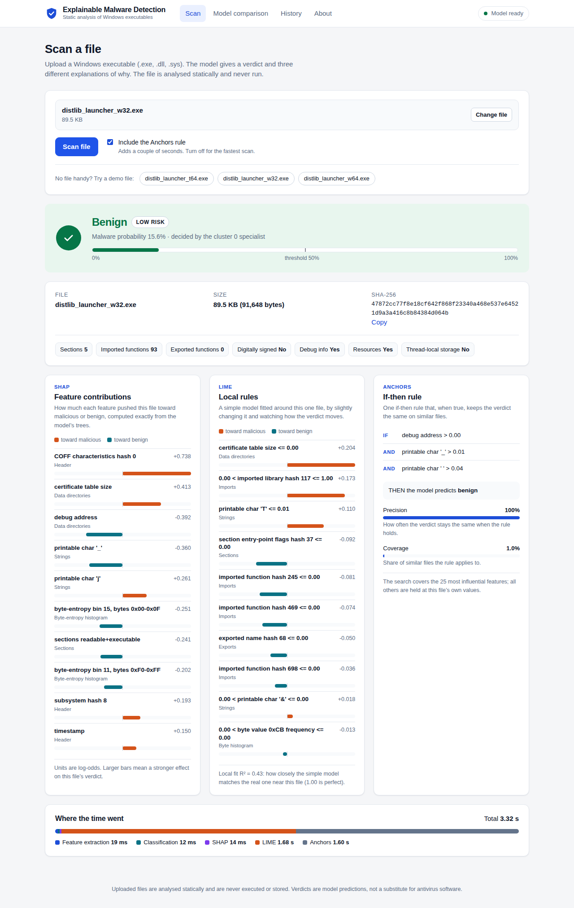

# Explainable Malware Detection

A web application that checks Windows executables (PE files) for malware and
explains each verdict. Upload a file, get a verdict with a probability, and see
three different explanations of why the model decided that: SHAP, LIME and
Anchors. Files are analysed statically and are never executed.

**Team:** K068 (Rishi) + K072 &nbsp;|&nbsp; Course project, Software Engineering



## What it does

- **Scan page.** Drag in a `.exe` or `.dll`. The result shows the verdict, the
  malware probability, the file's SHA-256, a few facts about the file, and the
  SHAP, LIME and Anchors explanations side by side, with timings.
- **Model comparison page.** The proposed model against the base paper on
  EMBER-2018: accuracy, precision, recall, F1 and ROC-AUC, with charts.
- **History page.** Every scan is saved locally (result only, never the file)
  and can be reopened.
- **About page.** The pipeline, the loaded model, and the limits of the system.
- **JSON API** with interactive documentation at `/docs`.

## Quick start

You need Python 3.10, 3.11 or 3.12 and Git.

```bash
git clone https://github.com/Rishi-V1/Bubo-AI-.git
cd Bubo-AI-/explainable-malware-detection
python run.py
```

The first run creates a virtual environment and installs the dependencies
(a few minutes). It then starts the server and opens
http://127.0.0.1:8000 in your browser. Later runs start in seconds.

On Windows, use `py run.py` if `python` is not found. In VS Code, open the
`explainable-malware-detection` folder, open a terminal, and run the same
command.

Prefer to manage the environment yourself?

```bash
python -m venv .venv
.venv\Scripts\activate            # Windows   (macOS/Linux: source .venv/bin/activate)
pip install -r requirements.txt
uvicorn backend.app:app --reload
```

### With Docker

```bash
docker build -t malware-detector .
docker run -p 8000:8000 malware-detector
```

## How it works

```
 Upload (PE file)
      |
      v
 Feature extraction ---- 2,381 static features (EMBER format): headers,
 backend/feature_extraction.py     sections, imports, strings, byte statistics
      |
      v
 K-means (3 clusters) -- routes the file to the cluster it resembles
      |
      v
 LightGBM specialist --- one model per cluster, general model as fallback
 src/models/clustered_lightgbm.py
      |
      v
 Verdict + probability
      |
      +--> SHAP     exact feature contributions (TreeSHAP on that cluster's model)
      +--> LIME     local surrogate model around the file
      +--> Anchors  if-then rule, searched over the 25 most influential features
```

The classifier follows Dener & Gulburun (2023): cluster first, then classify
with a specialist per cluster. Every specialist is LightGBM, so SHAP stays
exact. The explainers always explain the model that actually produced the
verdict, not an average over clusters.

### Project layout

```
backend/        FastAPI app, scan pipeline, scan history (SQLite), model loading
web/            The web UI (plain HTML, CSS and JavaScript, no build step)
src/models/     ClusteredLightGBM
src/explainability/   SHAP, LIME and Anchors wrappers + the engine that runs all three
src/features/   EMBER/BODMAS loaders and readable names for the 2,381 features
src/evaluation/ Cross-dataset and explanation-stability evaluation, survey tools
models/         Trained model + background sample (small, kept in the repo)
results/        model_metrics.json, read by the comparison page
samples/        Three harmless demo executables
scripts/        evaluate_model.py (measure the saved model on EMBER / BODMAS)
notebooks/      Colab notebook used for the full-scale training run
tests/          pytest suite
docs/           Project notes, survey method, UML class diagram, screenshots
```

### API

| Method | Path | Purpose |
|---|---|---|
| POST | `/api/scan` | Upload a file (`multipart/form-data`, field `file`; `?include_anchors=false` to skip Anchors) |
| GET | `/api/health` | Is the model loaded? |
| GET | `/api/model` | Clusters, trees and library versions of the loaded model |
| GET | `/api/history` | Saved scans and totals |
| GET | `/api/history/{id}` | One saved scan, full report |
| DELETE | `/api/history` | Clear the history |
| GET | `/api/metrics` | Results shown on the comparison page |

Errors are JSON `{"detail": "..."}` with the usual status codes: `400` empty
file, `413` file over 64 MB, `422` not a PE file, `503` model not loaded.

## Results

Trained on the full EMBER-2018 training set (Google Colab) and tested on the
EMBER-2018 test set:

| Metric | Base paper (LightGBM) | Proposed (clustered LightGBM) |
|---|---|---|
| Accuracy | 0.9116 | **0.9654** |
| Precision | 0.8852 | **0.9647** |
| Recall | 0.9422 | **0.9662** |
| F1-score | 0.9128 | **0.9654** |
| ROC-AUC | 0.9740 | **0.9938** |

The base paper (Al Siam et al., 2026) used a random 70/30 split of the labeled
EMBER data, while this project uses EMBER's official train/test split, so the
comparison is indicative rather than exact. The comparison page states this.

Two measurements are produced by `scripts/evaluate_model.py` and appear on the
comparison page once run: the plain-LightGBM baseline (what clustering adds)
and the EMBER to BODMAS generalization test.

```bash
python scripts/evaluate_model.py --ember-dir <folder with X_test.dat and y_test.dat> --bodmas <BODMAS .npz>
```

It only runs the saved model on data (no training), so it needs no GPU.

## Training

The model was trained by `notebooks/train_full.ipynb` on Google Colab, using the
same `src/` code as the app. Section 8 saves the two files in `models/`.
The EMBER and BODMAS datasets are not in the repository (multi-GB).

## Tests

```bash
pip install -r requirements-dev.txt
pytest
```

The suite covers the model, the three explainers (including Anchors timing out
gracefully), feature extraction on real and non-PE input, every API route and
error code, the scan history, and the evaluation code.

## Configuration

All optional, set as environment variables:

| Variable | Default | Meaning |
|---|---|---|
| `MODEL_PATH` | `models/clustered_lightgbm_ember.joblib` | Trained model |
| `BACKGROUND_PATH` | `models/background_sample.npy` | Sample used by LIME and Anchors |
| `HISTORY_DB_PATH` | `data/scan_history.db` | Scan history database |
| `METRICS_PATH` | `results/model_metrics.json` | Results for the comparison page |
| `MAX_UPLOAD_BYTES` | 67108864 | Upload size limit |
| `ANCHORS_TIMEOUT_SECONDS` | 30 | Give up on the Anchors rule after this long |

## Limitations

- Static analysis only. Malware that hides its behaviour until it runs can
  look benign. Dynamic analysis is out of scope.
- Windows PE files only; anything else is rejected with a clear error.
- Trained on EMBER-2018. Newer or very different malware may be missed.
  The EMBER to BODMAS test measures exactly this.
- Anchors searches the 25 most influential features, not all 2,381: a full
  search does not fit in memory at this width. Its precision and coverage are
  measured within that reduced space.
- LIME uses 1,000 samples per explanation (its default is 5,000) to keep a scan
  to a few seconds.
- A research and teaching tool, not a replacement for antivirus software. Do
  not run files from untrusted sources just because the verdict says benign.

## References

- Al Siam et al. (2026). *Peer-to-Peer Networking and Applications* 19:81. Base paper.
- Dener & Gulburun (2023). Clustering-aided supervised malware detection with
  specialized classifiers and early consensus. *CMC* 74(3).
- Mohseni et al. (2026). Why is SHAP not a reliable standalone explanation
  framework for malware detection? arXiv 2609.04626 (preprint).
- Anderson & Roth (2018). EMBER: an open dataset for training static PE malware
  machine learning models. Yang et al. (2021). BODMAS: an open dataset for
  learning based temporal analysis of PE malware.

Project history, the research questions and the survey method are in `docs/`.
